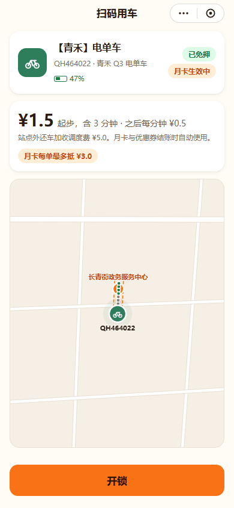
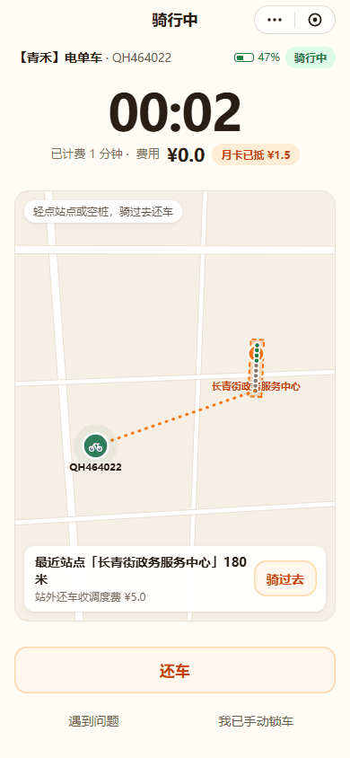
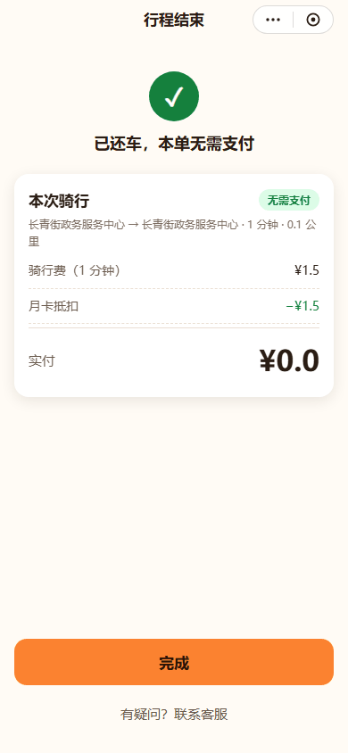
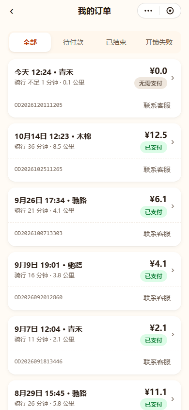
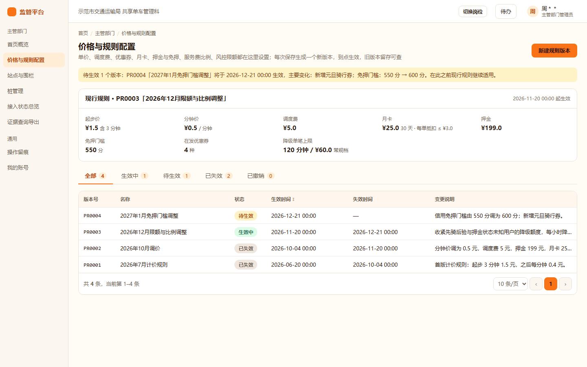
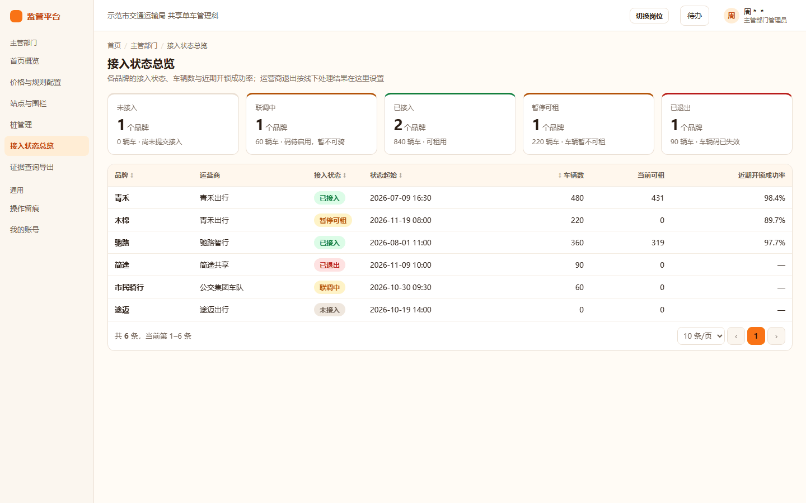
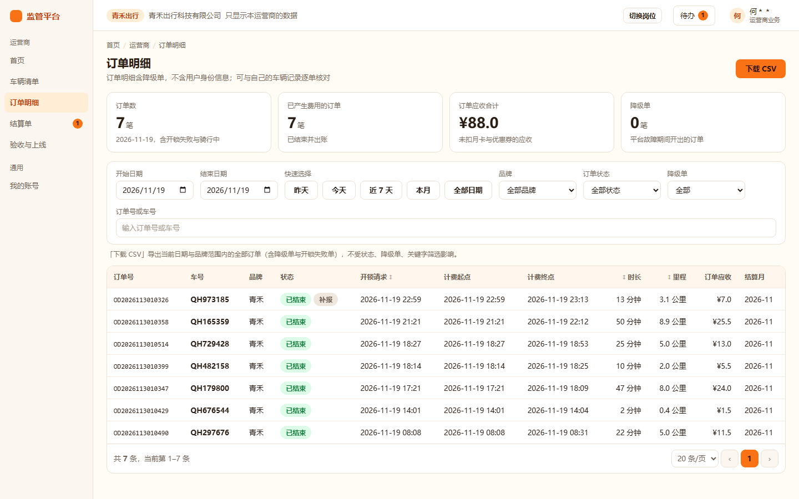
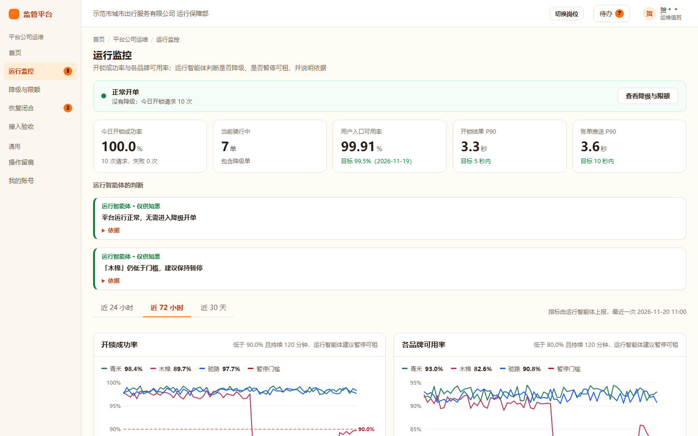
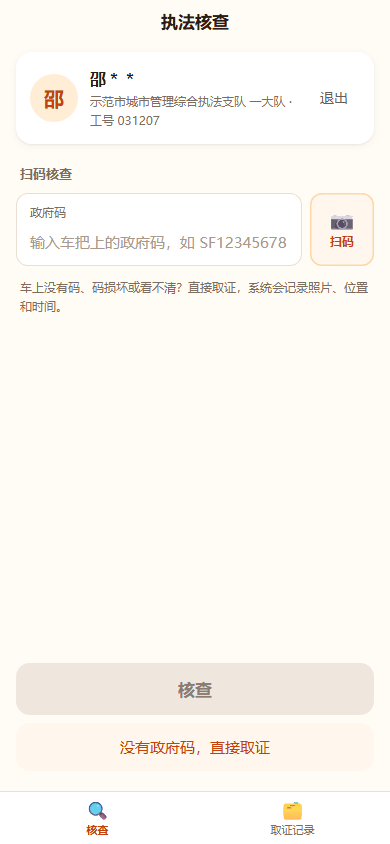

# Shared E-Bike Regulation Platform

**An open-source, city-level regulation platform for shared electric bikes and scooters — rider app, operator integration, pricing and geofencing, deposits, billing, settlement, customer service and enforcement, in one repository you can run on a laptop.**

> 共享电单车监管平台：面向城市主管部门、运营商与骑行用户的平台，源码公开（AGPL-3.0）。覆盖主管部门定价与围栏、运营商接入验收、骑行扫码开锁与还车、押金账单支付、月度结算、客服与执法取证。

[](LICENSE)


**Keywords:** shared e-bike, shared micromobility, bike sharing, e-scooter, smart city, municipal regulation, fleet management, operator integration, parking pile / dock IoT, billing, deposit, settlement, enforcement, open source, Go, Docker.

---

**▶ [Live demo in your browser](https://aixier.github.io/shared-ebike-platform/)** — rider app, admin console and enforcement page, running on fictional mock data with no backend. 在线体验：无需后端，数据为虚构。

**Contents:** [Why](#why-this-project) · [Architecture](#architecture) · [Services](#the-15-services) · [Quick start](#quick-start--one-container-demo) · [FAQ](#faq) · [License](#license) · [中文](#中文简介)

## Why this project

Cities that allow several shared e-bike operators need one place to **regulate** them: unified pricing and geofencing, a single view of operator integration and unlock success rate, enforcement evidence, deposits and refunds held by the platform, monthly settlement with operators, and a customer-service desk. Operators keep their own vehicles and IoT; the platform sits on top through a signed open API.

This repository is a complete reference implementation, organised the way a real city programme is run — **each business area is owned by one team and can be built, tested and replaced on its own**:

- **Each business stands alone.** Accounts, rides, money, operators, stations, rules and customer service each have their own data and their own team. They talk to each other only through the agreed interfaces and notices written in `contracts/`, so one area can change without breaking the others.
- **Riding keeps working when other areas have trouble.** Scan → unlock → return only needs the ride service and the operator's own system. If billing, customer service or monitoring is down, riders can still start and finish trips, and the books are settled afterwards.
- **Piles from any vendor.** Parking piles and controllers from different vendors report through one standard message, so a city can mix vendors.

## Screenshots

**Rider app** (mobile) — scan, ride, bill, orders

| Scan & unlock | Riding | Trip bill | My orders |
|---|---|---|---|
|  |  |  |  |

**Admin console** (desktop) — five roles: regulator, operator, finance, customer service, operations

| Pricing & rules | Operator integration status |
|---|---|
|  |  |
| **Operator orders** | **Monitoring & degradation** |
|  |  |

**Monthly settlement** and **enforcement (mobile)**

| Settlement | Enforcement home | Code check |
|---|---|---|
|  |  |  |

## How it fits together

```
 FRONTEND                                            EXTERNAL SYSTEMS
 +-----------+ +-----------+ +-----------+   +-----------+ +---------+ +-----------------+
 |  rider H5 | |   admin   | |  enforce  |   | operator  | |  piles  | | payment / real- |
 |  (app)    | | 5 roles   | |  mobile   |   | systems   | |  (IoT)  | | name / credit   |
 +-----+-----+ +-----+-----+ +-----+-----+   +-----+-----+ +----+----+ +--------+--------+
       |             |             |               |            |               |
       +----- HTTPS  /api/<service>/ -----+   /open/v1      MQTT / HTTP     called by
                     |                          (signed)   /device/v1       pay and acct
 +-------------------v-----------------------------v-------------v-----+
 |  GATEWAY: one entry point; internal interfaces are never exposed     |
 +--+------+------+------+------+------+------+------+------+------+----+
    |      |      |      |      |      |      |      |      |      |
 +--v------v------v------v------v------v------v------v------v------v----+
 | 15 SERVICES - one team, one process, one database each             |
 |                                                                      |
 |  HOT PATH   ride <----> opgw <----> operator systems                  |
 |                                                                      |
 |  rider side    money         operator side      governance           |
 |  acct   cs     bill  pay     fleet  onboard     rule   site          |
 |                deposit       settle ops          enforce iam         |
 +----------------------------+---------------------+-------------------+
                              |  direct calls between services (see contracts/openapi)
 +============================v=======================================+
 | NOTICE BUS (NATS): each service publishes its own business notices; |
 | others keep their own copy of what they need                         |
 +=====================================================================+
 | PostgreSQL: 15 separate databases, one per service, isolated        |
 +---------------------------------------------------------------------+
```

### The 15 services

| Service | Responsibility |
|---|---|
| `acct` | Rider accounts, authorization, real-name verification, freeze / cancel |
| `ride` | Scan, unlock, riding, return, in-station decision, force end (hot path) |
| `opgw` | Open API for operators: signing, unlock / end-ride, ride events (hot path) |
| `onboard` | Operator integration: sandbox, conformance tests, acceptance, go-live |
| `fleet` | Operators, brands, vehicle lists, government codes, rentable status |
| `site` | Stations, geofences, parking piles; the only service that talks to piles |
| `rule` | Versioned pricing and platform parameters |
| `bill` | Pricing, bills, coupons, monthly cards, arrears |
| `pay` | Payment channels (WeChat Pay, Alipay, mock), refunds, reconciliation |
| `deposit` | Deposits and credit-free deposits |
| `settle` | Monthly settlement and disputes with operators |
| `cs` | Customer-service tickets and refund confirmation |
| `ops` | Monitoring, degradation and recovery, brand pause by unlock success rate |
| `enforce` | Enforcement evidence collection |
| `iam` | Admin accounts, roles, permissions, audit log, token issuing |

## What is in the repository

```
backend/<service>/     One folder per business area, with its own code, data tables and tests
contracts/openapi/     Interface description of every service, plus common rules (errors, paging)
contracts/operator-spec/  Interface that operators implement and call
deploy/local/          Windows/Git Bash local stack scripts (PostgreSQL, NATS, Caddy, seed)
deploy/docker/         One-container demo (front end + all 15 services + database + gateway)
deploy/prod/           Production deployment templates
deploy/cities/         Per-city configuration template (one deployment per city)
原型/                   Front-end prototype (rider H5, admin, enforcement mobile) with a mock mode
                       and a real-backend mode (?backend=1)
```

## Built with

Go 1.25, PostgreSQL 16, NATS, Caddy, and plain HTML/CSS/JavaScript for the front end. Tests need no external services.

## Quick start — one container (demo)

Requires Docker.

```bash
bash deploy/docker/build.sh
docker run -d --name bike-single -p 127.0.0.1:28300:18300 \
  -v bike-single-data:/data -e IAM_DEV_SEED_ADMIN=1 \
  --stop-timeout 40 --restart unless-stopped bike-single:local
bash deploy/docker/seed.sh      # operators, brands, prices, stations, piles, vehicles
bash deploy/docker/verify.sh    # health, DB isolation, NATS, gateway checks
bash deploy/docker/e2e.sh       # authorize → scan → unlock → return → bill → pay
```

Then open:

- Rider app: <http://127.0.0.1:28300/app/index.html?backend=1>
- Admin: <http://127.0.0.1:28300/admin/index.html?backend=1> — demo account `admin` / `Shifan@2026` (read-only, enabled only by `IAM_DEV_SEED_ADMIN=1`)

> The single image is for demos and single-machine delivery. It bundles everything into one container, which gives up independent deployment and upgrade of services. For production, run each service separately (see `deploy/prod/`).

## Run and test a service

```bash
cd backend/ride
go build ./... && go vet ./... && go test ./...
```

Every service is configured through environment variables (port, database, message bus, keys). Services listen on the local address by default, so running tests never triggers an operating-system firewall prompt.

## Working rules

1. Each business area keeps its own code and data; the only thing shared is `contracts/`.
2. Money is counted in cents, so there are no rounding surprises; times are written in one standard format; errors look the same everywhere.
3. A retried request never charges or creates anything twice; a notice that arrives twice is handled once.
4. Each outside party is dealt with by exactly one service: operators → `opgw`, piles → `site`, payment → `pay`, authorization and real-name → `acct`.
5. Payment, real-name and credit channels can run in demo mode, so the whole flow works without merchant accounts. Real WeChat Pay is a skeleton, Alipay is not connected.

## Status

All 15 services build, vet and pass their tests; the main chain (scan → unlock → return → bill → pay → order list) runs end to end against mock operators and a pile simulator. Not done: real payment / real-name / credit channels (need merchant credentials), HTTPS, and the four optional AI-agent features (customer service, reconciliation, onboarding, operations), which are intentionally left until an agent runtime is chosen.

## Contributing

Issues and pull requests are welcome. Please keep one rule: **don't make one business area depend on another's internals** — agree the interface or notice in `contracts/` first, then change the code and add tests.

## FAQ

**Is there an open-source backend for shared e-bike or e-scooter city regulation?**
Yes — this repository: operator onboarding and acceptance, unlock-success-rate monitoring, pricing and geofence rules, enforcement evidence, deposits, billing, payments and monthly settlement, all as separate Go services.

**How do operators integrate with the platform?**
Through the signed open interface served by `opgw` (`/open/v1`), described in `contracts/operator-spec/operator-api.yaml`. `onboard` provides a sandbox, conformance tests and an acceptance flow.

**How do parking piles / docks from different vendors connect?**
Only `site` talks to piles. It accepts one standard message (MQTT or HTTP, `/device/v1/`), and vendor adapters translate proprietary formats into it.

**Can I run it on my laptop?**
Yes: one Docker container (see Quick start), or each service with `go run` plus the scripts in `deploy/local/`.

**Can several teams work on it at once?**
Yes. Each business area has its own folder, data and tests, and teams only agree on the interfaces and notices in `contracts/`.

**Does it use real payment?**
Not out of the box. Payment, real-name and credit-free deposit channels run in mock mode; WeChat Pay is a skeleton and Alipay is not connected.

## License

Copyright (C) 2026 樊荣. Licensed under the [GNU Affero General Public License v3.0](LICENSE) (AGPL-3.0).

- You may use, modify and distribute it, including commercially, under the AGPL terms.
- Keep the copyright and license notices, and state your changes.
- If you modify it and distribute it, **or let users interact with it over a network**, you must offer the complete corresponding source of your version under the same license.

---

## 中文简介

**共享电单车监管平台**：城市主管部门、运营商和骑行用户共用的监管平台参考实现。

- **按业务分工**：账号、骑行、资金、运营商、站点、规则、客服等 15 块业务各自独立，数据各管各的，彼此只按约定好的接口和通知往来，适合多个团队同时推进。
- **骑行不被别处拖累**：扫码、开锁、还车只依赖骑行服务和运营商自己的系统；计费、客服、监控出问题时用户仍能正常用车，事后补账。
- **多厂商的桩都能接**：各家的停车桩用同一种标准消息上报，一个城市可以混用多家桩。
- **覆盖业务**：价格与围栏、运营商接入与验收、车辆码与可租状态、押金与免押、账单与优惠券、支付与退款、月度结算与异议、客服、运行监控与降级、执法取证、账号与审计。
- **一个容器就能演示**：一个 Docker 镜像包含前端、15 项业务服务、数据库和网关，见上面的 Quick start。
- **自测方便**：每个服务自带测试，不需要额外装任何外部服务，也只在本机地址监听，不会触发系统防火墙提示。

支付、实名、信用免押的真实渠道需要商户资质，仓库内是模拟渠道；欢迎提 Issue 与 PR。

**许可证（AGPL-3.0，版权所有 © 2026 樊荣）**：可使用、修改、分发；保留版权与许可声明并标明改动；修改后分发，或通过网络向用户提供服务时，必须以同一协议公开完整源码，开源传递下去。
