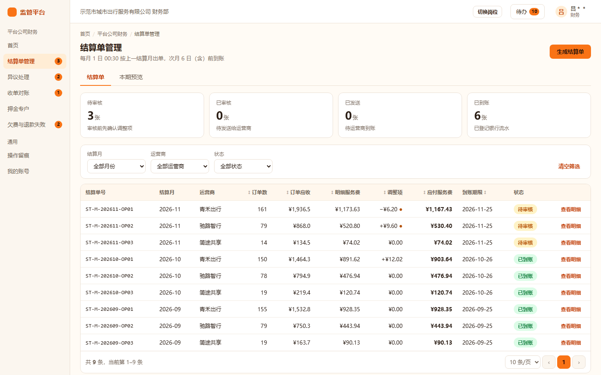
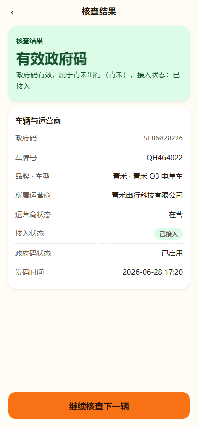

# Shared E-Bike Regulation Platform

**An open-source, city-level regulation platform for shared electric bikes and scooters — 15 fully decoupled Go microservices, OpenAPI 3 contracts, event-driven integration over NATS JetStream, one PostgreSQL database per service, and a one-container demo.**

> 共享电单车监管平台：面向城市主管部门、运营商与骑行用户的平台（源码公开，非商用）。15 个完全解耦的 Go 微服务，每个服务独立进程、独立数据库、没有任何共享代码包；服务之间只靠 OpenAPI 契约和事件通信。

[](LICENSE)


**Keywords:** shared e-bike, shared micromobility, bike sharing, e-scooter, smart city, municipal regulation, fleet management, operator integration, microservices, Go, golang, event-driven architecture, NATS JetStream, PostgreSQL, OpenAPI, MQTT, parking pile / dock IoT, billing, deposit, settlement, Docker.

---

**▶ [Live demo in your browser](https://aixier.github.io/shared-ebike-platform/)** — rider app, admin console and enforcement page, running on fictional mock data with no backend. 在线体验：无需后端，数据为虚构。

**Contents:** [Why](#why-this-project) · [Architecture](#architecture) · [Services](#the-15-services) · [Quick start](#quick-start--one-container-demo) · [FAQ](#faq) · [License](#license) · [中文](#中文简介)

## Why this project

Cities that allow several shared e-bike operators need one place to **regulate** them: unified pricing and geofencing, a single view of operator integration and unlock success rate, enforcement evidence, deposits and refunds held by the platform, monthly settlement with operators, and a customer-service desk. Operators keep their own vehicles and IoT; the platform sits on top through a signed open API.

This repository is a complete reference implementation, built so that **many teams can develop modules in parallel**:

- **Decoupling over reuse.** Every service is its own Go module, process and database. There is *no* shared library, no `go.work`, no `replace`. The only thing services share is the contract (OpenAPI + event schemas).
- **The ride hot path survives outages.** Scan → unlock → return only needs `ride` ↔ `opgw` ↔ the operator system. It does not depend on the event bus, the database of other services, or the other 13 services; each service keeps its own projections for degraded ordering.
- **Compatible pile (dock) access.** Parking piles and controllers from any vendor connect through one standard message format (embedded MQTT first, HTTP second, vendor adapters as a fallback), so a city can mix vendors.

## Screenshots

**Rider app** (mobile) — scan, ride, bill, orders

| Scan & unlock | Riding | Trip bill | My orders |
|---|---|---|---|
|  |  |  |  |

**Admin console** (desktop) — five roles: regulator, operator, finance, customer service, operations

| Pricing & rules | Operator integration status |
|---|---|
|  |  |
| **Operator orders** | **Monitoring & degradation** |
|  |  |

**Monthly settlement** and **enforcement (mobile)**

| Settlement | Enforcement home | Code check |
|---|---|---|
|  |  |  |

## Architecture

```
 FRONTEND                                            EXTERNAL SYSTEMS
 +-----------+ +-----------+ +-----------+   +-----------+ +---------+ +-----------------+
 |  rider H5 | |   admin   | |  enforce  |   | operator  | |  piles  | | payment / real- |
 |  (app)    | | 5 roles   | |  mobile   |   | systems   | |  (IoT)  | | name / credit   |
 +-----+-----+ +-----+-----+ +-----+-----+   +-----+-----+ +----+----+ +--------+--------+
       |             |             |               |            |               |
       +----- HTTPS  /api/<service>/ -----+   /open/v1      MQTT / HTTP     called by
                     |                          (signed)   /device/v1       pay and acct
 +-------------------v-----------------------------v-------------v-----+
 |  GATEWAY: routes by path, serves static files, never exposes /internal|
 +--+------+------+------+------+------+------+------+------+------+----+
    |      |      |      |      |      |      |      |      |      |
 +--v------v------v------v------v------v------v------v------v------v----+
 | 15 SERVICES - one Go module, one process, one database each           |
 |                                                                      |
 |  HOT PATH   ride <----> opgw <----> operator systems                  |
 |                                                                      |
 |  rider side    money         operator side      governance           |
 |  acct   cs     bill  pay     fleet  onboard     rule   site          |
 |                deposit       settle ops          enforce iam         |
 +----------------------------+---------------------+-------------------+
                              |  sync HTTP (15 directions, see openapi)
 +============================v=======================================+
 | EVENT BUS (NATS JetStream): per-service outbox -> publish;          |
 | per-service durable consumers -> own projections                    |
 +=====================================================================+
 | PostgreSQL: one instance, 15 databases, 15 accounts (isolated)       |
 +---------------------------------------------------------------------+
```

### The 15 services

| Service | Responsibility |
|---|---|
| `acct` | Rider accounts, authorization, real-name verification, freeze / cancel |
| `ride` | Scan, unlock, riding, return, in-station decision, force end (hot path) |
| `opgw` | Open API for operators: signing, unlock / end-ride, ride events (hot path) |
| `onboard` | Operator integration: sandbox, conformance tests, acceptance, go-live |
| `fleet` | Operators, brands, vehicle lists, government codes, rentable status |
| `site` | Stations, geofences, parking piles; the only service that talks to piles |
| `rule` | Versioned pricing and platform parameters |
| `bill` | Pricing, bills, coupons, monthly cards, arrears |
| `pay` | Payment channels (WeChat Pay, Alipay, mock), refunds, reconciliation |
| `deposit` | Deposits and credit-free deposits |
| `settle` | Monthly settlement and disputes with operators |
| `cs` | Customer-service tickets and refund confirmation |
| `ops` | Monitoring, degradation and recovery, brand pause by unlock success rate |
| `enforce` | Enforcement evidence collection |
| `iam` | Admin accounts, roles, permissions, audit log, token issuing |

## Repository layout

```
backend/<service>/     Go module (bike/<service>), cmd/, internal/, migrations/ (goose, embedded)
contracts/openapi/     OpenAPI 3.0.3 for every service + _common.yaml (errors, paging)
contracts/operator-spec/  Open API that operators implement and call
deploy/local/          Windows/Git Bash local stack scripts (PostgreSQL, NATS, Caddy, seed)
deploy/docker/         Single-image demo (frontend + 15 services + PostgreSQL + NATS + Caddy)
deploy/prod/           systemd / PostgreSQL / NATS templates for production
deploy/cities/         Per-city configuration template (one deployment per city)
原型/                   Front-end prototype (rider H5, admin, enforcement mobile) with a mock mode
                       and a real-backend mode (?backend=1)
```

## Tech stack

Go 1.25 · `net/http` · PostgreSQL 16 (`pgx/v5`, hand-written SQL, `goose` migrations) · NATS JetStream · EdDSA JWT · `mochi-mqtt` (embedded MQTT in `site`) · Caddy · plain HTML/CSS/ES modules for the front end. Tests use the standard `testing` package with embedded PostgreSQL and an in-process NATS server — no external services needed.

## Quick start — one container (demo)

Requires Docker.

```bash
bash deploy/docker/build.sh
docker run -d --name bike-single -p 127.0.0.1:28300:18300 \
  -v bike-single-data:/data -e IAM_DEV_SEED_ADMIN=1 \
  --stop-timeout 40 --restart unless-stopped bike-single:local
bash deploy/docker/seed.sh      # operators, brands, prices, stations, piles, vehicles
bash deploy/docker/verify.sh    # health, DB isolation, NATS, gateway checks
bash deploy/docker/e2e.sh       # authorize → scan → unlock → return → bill → pay
```

Then open:

- Rider app: <http://127.0.0.1:28300/app/index.html?backend=1>
- Admin: <http://127.0.0.1:28300/admin/index.html?backend=1> — demo account `admin` / `Shifan@2026` (read-only, enabled only by `IAM_DEV_SEED_ADMIN=1`)

> The single image is for demos and single-machine delivery. It bundles everything into one container, which gives up independent deployment and upgrade of services. For production, run each service separately (see `deploy/prod/`).

## Run and test a service

```bash
cd backend/ride
go build ./... && go vet ./... && go test ./...
```

Every service reads its configuration from environment variables (`PORT`, `LISTEN_HOST` default `127.0.0.1`, `DB_DSN`, `NATS_URL`, token public keys, service credentials). Services listen on loopback by default, so running tests never triggers an operating-system firewall prompt.

## Design rules

1. No shared code between services. The only shared artifact is `contracts/`.
2. Money is an integer number of cents; time is RFC 3339; errors follow `contracts/openapi/_common.yaml`.
3. Writes carry an `Idempotency-Key`; events use a transactional outbox and are de-duplicated by `eventId` on the subscriber.
4. Each external system is reached by exactly one service: operators → `opgw`, piles → `site`, payment → `pay`, authorization and real-name → `acct`.
5. Payment, real-name and credit channels have `mock | real` switches; the repository runs end to end with the mock channels. Real WeChat Pay is a skeleton, Alipay is not connected.

## Status

All 15 services build, vet and pass their tests; the main chain (scan → unlock → return → bill → pay → order list) runs end to end against mock operators and a pile simulator. Not done: real payment / real-name / credit channels (need merchant credentials), HTTPS, and the four optional AI-agent features (customer service, reconciliation, onboarding, operations), which are intentionally left until an agent runtime is chosen.

## Contributing

Issues and pull requests are welcome. Please keep the one rule that makes parallel work possible: **do not add shared packages between services** — change the contract first (`contracts/openapi/<service>.yaml`), then the code, with tests.

## FAQ

**Is there an open-source backend for shared e-bike or e-scooter city regulation?**
Yes — this repository: operator onboarding and acceptance, unlock-success-rate monitoring, pricing and geofence rules, enforcement evidence, deposits, billing, payments and monthly settlement, all as separate Go services.

**How do operators integrate with the platform?**
Through the signed Open API served by `opgw` (`/open/v1`), described in `contracts/operator-spec/operator-api.yaml`. `onboard` provides a sandbox, conformance tests and an acceptance flow.

**How do parking piles / docks from different vendors connect?**
Only `site` talks to piles. It accepts one standard message format over embedded MQTT or HTTP (`/device/v1/`), and vendor adapters translate proprietary protocols into it.

**Can I run it on my laptop?**
Yes: one Docker container (see Quick start), or each service with `go run` plus the scripts in `deploy/local/`.

**How is a microservice architecture kept truly decoupled?**
No shared packages: each service is its own Go module with its own database and migrations. Services only share OpenAPI contracts and event schemas.

**Does it use real payment?**
Not out of the box. Payment, real-name and credit-free deposit channels run in mock mode; WeChat Pay is a skeleton and Alipay is not connected.

## License

Copyright (C) 2026 樊荣. Licensed under the [GNU Affero General Public License v3.0](LICENSE) (AGPL-3.0).

- You may use, modify and distribute it, including commercially, under the AGPL terms.
- Keep the copyright and license notices, and state your changes.
- If you modify it and distribute it, **or let users interact with it over a network**, you must offer the complete corresponding source of your version under the same license.

---

## 中文简介

**共享电单车监管平台**：城市主管部门、运营商和骑行用户共用的监管平台参考实现。

- **解耦大于复用**：15 个服务各自是独立的 Go 模块、独立进程、独立的 PostgreSQL 库，没有公共代码包，只共享契约（OpenAPI 与事件）。适合多团队并行开发。
- **扫码开锁热路径独立**：只依赖 `ride`、`opgw` 和运营商系统，事件总线、数据库、其余服务出故障也能开单。
- **兼容多厂商的桩接入**：标准桩消息，MQTT 为主、HTTP 并存、厂商适配器兜底，一个城市可以混用多家桩。
- **覆盖业务**：价格与围栏、运营商接入与验收、车辆码与可租状态、押金与免押、账单与优惠券、支付与退款、月度结算与异议、客服、运行监控与降级、执法取证、账号与审计。
- **一条命令演示**：单个 Docker 镜像包含前端、15 个服务、PostgreSQL、NATS 与网关，见上面的 Quick start。
- **测试方式**：每个服务 `go build`、`go vet`、`go test` 即可，测试用内嵌 PostgreSQL 与进程内 NATS，只监听 `127.0.0.1`，不会触发系统防火墙提示。

支付、实名、信用免押的真实渠道需要商户资质，仓库内是模拟渠道；欢迎提 Issue 与 PR。

**许可证（AGPL-3.0，版权所有 © 2026 樊荣）**：可使用、修改、分发；保留版权与许可声明并标明改动；修改后分发，或通过网络向用户提供服务时，必须以同一协议公开完整源码，开源传递下去。
